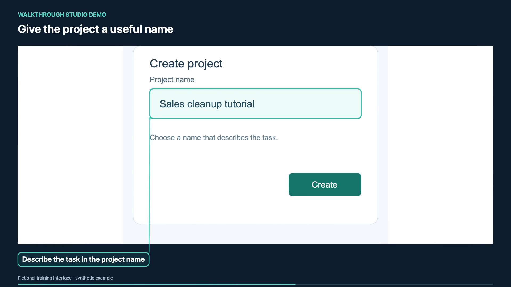
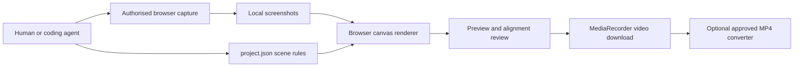

# Walkthrough Studio

A local, browser-first prototype for turning **reviewed screenshots into silent tutorial videos**. A coding agent can prepare the screenshots and scene file; the renderer itself uses ordinary JavaScript and browser media APIs.

It packages the useful parts of an agent-guided video-production workflow into one editable project format. It is not an automatic SOP recorder or a replacement for a mature documentation platform.



## Start without Python, Node, MCP or a build step

1. Open `studio/index.html` in a desktop browser.
2. Click **Open project folder** and select `examples/demo`.
3. Play the preview, inspect the highlights, or edit the JSON and click **Apply edits**.
4. Click **Export video** and keep the tab visible until the download finishes.

The demo is a **fictional training interface**, clearly labelled in its screenshots. It contains no real customer, employer or application data.

Browser support and enterprise policy vary. Test the intended managed browser before relying on it. Export usually produces WebM; MP4 is selected only if the browser reports support. MP4 conversion is an optional separate step. There is no voice, microphone access or cloud generation service.

For development, if Node 20+ is available:

```sh
npm test
npm run check -- examples/demo/project.json
npm run serve
```

Then open `http://127.0.0.1:4173/studio/` and click **Load fictional demo**. No npm dependencies are needed for these commands.

## What it does

- Loads a local project folder containing `project.json` and screenshots.
- Previews titles, timed highlights, leader lines and eased screenshot zooms.
- Uses one source-image transform for both screenshots and annotations.
- Caps image enlargement at 1.5× to avoid aggressive digital zoom.
- Refuses image-dimension mismatches and out-of-bounds rectangles.
- Lets you edit and download scene JSON without changing the original file.
- Exports the canvas as video with optional user-selected music, without narration.
- Cancels exports when the tab becomes hidden rather than silently producing a throttled recording.
- Provides optional Node/Playwright capture and FFmpeg conversion utilities.

It does **not** automatically discover steps, verify annotations against pixels, redact sensitive data, maintain changed interfaces, or provide team hosting/approvals. Capture selectors and screenshot coordinates need review.

## How the parts fit together



Capture and rendering are deliberately separate. You can use an agent's built-in browser tools, the optional Playwright adapter, or manual screenshots. MCP is not required. A prompt describes the work; reusable agent instructions guide it; actual browser and execution capabilities still have to exist in the environment.

## Files

| Path | Purpose |
|---|---|
| `studio/index.html` | Local interface and canvas preview. |
| `studio/core.js` | Manifest validation, timeline, camera and coordinate mapping. |
| `studio/app.js` | File loading, drawing, JSON editing, preview and browser export. |
| `examples/demo/project.json` | Three-scene example using source-pixel rectangles. |
| `examples/demo/screens/` | Clearly labelled fictional SVG screenshots. |
| `capture/playwright.mjs` | Optional headful capture with a user authentication handoff. |
| `capture/plan.example.json` | Reviewed navigation actions and provisional targets. |
| `scripts/convert.cjs` | Optional FFmpeg conversion; refuses to overwrite a file. |
| `tests/core.test.cjs` | Coordinate, source-dimension, timing and format tests. |
| `AGENTS.md` | Reusable operating instructions for a coding agent. |

See [the scene format](docs/project-format.md), [capture workflow](docs/capture.md), [architecture and portability](docs/architecture.md), and [comparison with Scribe, Tango and Guidde](docs/comparison.md).

The [validation record](docs/validation.md) separates tested behaviour from capabilities that still need environment-specific checks.

## Compared with SOP tools

For routine SOP capture with minimal engineering, an approved product such as Scribe or Tango is generally the practical starting point. This project is useful when you want local source files, custom animation rules, agent-driven editing and a video artifact you can rebuild yourself.

The distinction is **not simply static guides versus video**: Scribe supports Movies, and Tango supports video embeds and in-app guidance. Guidde also targets video documentation. The comparison documents those overlaps and the maintenance work this project still requires, using official sources checked on 20 November 2026.

## Data and reversibility

The Studio has no application upload endpoint, analytics or external font/CDN dependency. Local files are opened through browser file inputs. Running an AI coding agent, optional capture against a real service, GitHub pushes or hosting introduces separate data handling; local rendering does not make those activities offline or automatically approved.

Captures, authentication profiles, personal projects, music and video outputs are ignored by Git. Keep new project versions and export filenames rather than replacing earlier ones. Downloads include a timestamp. There is **no automatic redaction**, so review screenshots before sharing them.

This repository contains the generic prototype and fictional sample only. It does not include the original application screenshots, hiring materials, credentials or finished submission video. No open-source licence has been selected yet.
